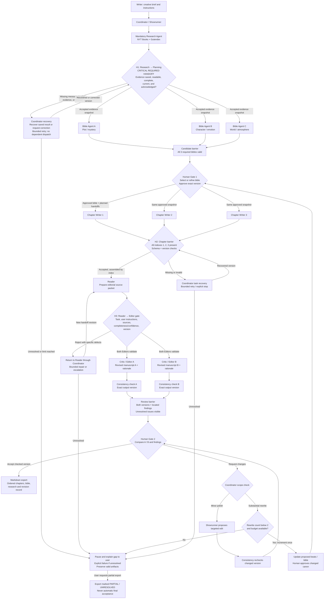
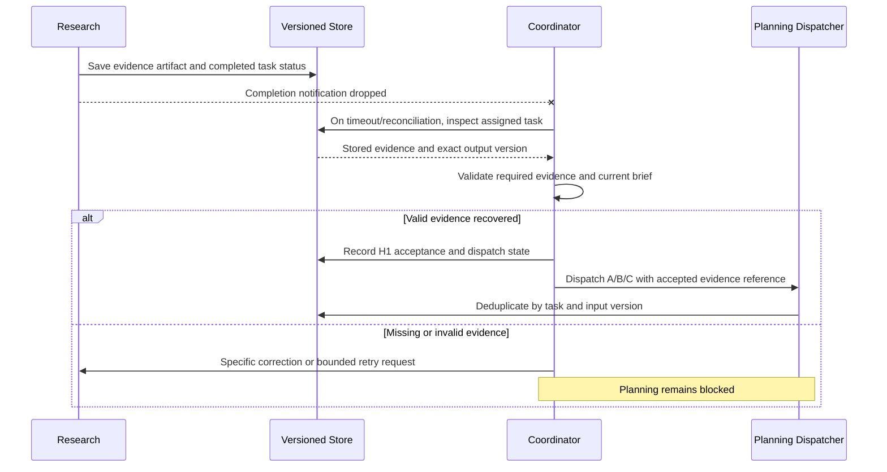
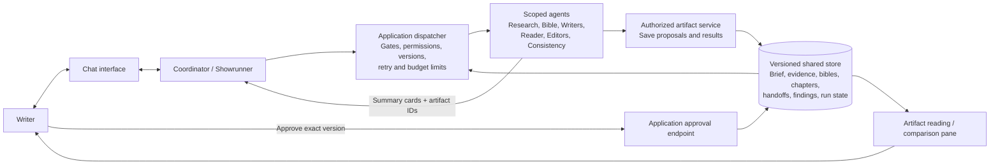

# Multi-Agent Story Builder: Architecture and Workflow v2

**Status: DRAFT — not submitted, implemented, or evaluated.**

This separate architecture is based on `multi-agent-workflow.md`, the supplied PRD, the PRD v2 draft, and the user's correction that Research is mandatory. The original workflow and PRD remain unchanged. The three candidate bibles, three parallel chapter writers, two alternative editorial versions, human selection gates, artifact storage, and two-rewrite limit come from the workflow. Explicit validation, delivery recovery, Reader and Consistency stages are proposed architecture details that make the agreed requirements visible.

## 1. Architecture decisions

- **Mandatory research:** Research uses NYT Books and Gutendex as the intended sources before planning starts. No silent story-only fallback. Both source outcomes must be recorded, and missing required evidence blocks planning pending recovery or an explicit user scope decision.
- **Purpose:** Inform an original story using evidence about real-world books, bestseller signals, and supported observations about narrative craft. Metadata is not prose analysis or proof of why a book succeeded. Text-based observations require identified, accessible text and verified permitted use; no claim is made that Gutendex supplies the same books as NYT Books.
- **Pattern:** Coordinator-led orchestration with structured handoffs, a versioned shared store, sequential phase gates, and parallel workers within phases. This is not an unrestricted reactive blackboard.
- **Visible critical dependency:** Research → Planning is labeled H1, the weakest evidence dependency and a required planning gate. Approved-bible delivery, chapter assembly, and Reader → Editor are also blocking dependencies.
- **Source correction:** The original runtime diagram dispatches Research and Bible agents together. This version permits Bible dispatch only after research acceptance, aligning it with the original main diagram and the user's mandatory-research requirement.

## 2. Agent roles

| Agent | Responsibility | Boundary |
| --- | --- | --- |
| Coordinator / Showrunner | Conversational interface; records user instructions; dispatches tasks; enforces gates, versions, budgets, recovery, and human decisions. | Cannot approve its own creative proposals or change story direction autonomously. |
| Research | Retrieves NYT Books and Gutendex references and evidence; separates metadata, text observations, interpretations, and gaps. | Mandatory; cannot invent unavailable titles, text, ratings, or stylistic evidence. Provider availability remains to be verified before implementation. |
| Bible A / B / C | Independently produce candidate bibles: plot and mystery; character and emotion; world and atmosphere. Each includes stable fact IDs and three chapter beats. | Start only after H1 acceptance; proposals do not become canon until human approval. |
| Chapter Writers 1 / 2 / 3 | Draft assigned chapters concurrently against the same approved bible and planned milestone handoffs. | Cannot depend on unfinished prose from another concurrent writer or alter canon. |
| Reader | Reads the assembled manuscript and relevant sources; prepares a complete versioned editorial handoff. | Extracts task data, not new authority; reports missing evidence explicitly. This stage is made explicit in v2. |
| Critic / Editor A and B | Validate the Reader handoff, then independently produce complete revised versions with rationale. A emphasizes continuity and pacing; B emphasizes voice and atmosphere. | Cannot bypass invalid inputs, change approved canon, or commit approved state. |
| Consistency | Independently checks each revised version against approved facts, chapter order, terminology, and user constraints. | Reports located findings for the exact checked version; cannot approve on the writer's behalf. This stage is made explicit in v2. |

## 3. Updated end-to-end architecture

All model dispatches, including repairs and polish, are subject to remaining budget and cancellation checks. Human approval applies to a specific artifact version. A check attached to an earlier manuscript does not validate a newer edit.

## 4. Handoff contents and acceptance

Every handoff identifies project/run/task, producer and intended consumer, artifact ID and revision, input versions, status, timestamp, and trace reference. The application verifies ownership, task state, schema, and versions; consumers verify semantic sufficiency. These supporting envelope fields are proposed implementation details.

| Boundary | Payload | Acceptance rule |
| --- | --- | --- |
| Coordinator → Research | Authorized creative brief, genre/keywords, research purpose, required evidence criteria, source scope, budget and task version. | Task and evidence criteria are explicit; required credentials and access are checked before dispatch. |
| **H1 Research → Planning** | Titles/authors/provider IDs, source links and retrieval dates, provider outcomes, bestseller signals where available, matched-book confidence, available text references and permitted-use status, located craft observations, interpretations labeled separately, coverage and missing evidence, evidence version. | Persisted evidence is readable and matches the current brief; required coverage is satisfied; unsupported style claims are rejected. No arbitrary numeric evidence threshold is asserted as agreed. |
| Planning → Human Gate 1 | Three complete candidate bibles, stable fact IDs, world/character rules, three chapter beats, research citations, and candidate versions. | All required candidates are present and valid; user selects/refines and approves one exact version. |
| Approved Bible → Writers | Approved bible ID/version, canonical facts, assigned chapter index and beats, planned prior events and resolution targets, authorized user instructions. | All writers use the same snapshot. Prior-event summaries are plans, not claims about already completed parallel prose. |
| **H2 Writers → Assembly** | Indexed chapter text/artifact, task ID, bible version, completion status, gaps, and errors. | Exactly one accepted chapter for each required index; no mixed bible versions or canceled/stale writes. Semantic continuity still requires review; schema validation alone cannot establish it. |
| **H3 Reader → Editors** | Required task and completion criteria; authorized user instructions and provenance; readable source references with locators; completeness/confidence and gaps; schema, handoff, task, manuscript, and bible versions. | Both application and Editor validation pass. Empty fields, unresolved required gaps, stale versions, or document text presented as user authority cause rejection before dependent editing. |
| Editors → Consistency | Full revised version A or B, base/input versions, change rationale/diff, affected passages/fact IDs, research references where relevant, unresolved issues. | Independent alternatives remain separate; all required chapters are present and sources are traceable. |
| Consistency → Human Gate 2 | Reviewed version, located findings, severity, supporting fact/source references, coverage, and unresolved conflicts. | Checks match exact current outputs; unresolved critical findings block a ready-for-final-acceptance label. User may request changes or explicitly export partial work. |
| User acceptance → Export | Authenticated selection and exact accepted artifact version; ordered chapters, approved bible, research references, revision record, unresolved issues/status. | No agent self-approval; export does not silently merge alternatives or treat partial work as complete. |

## 5. Dropped-message and invalid-handoff recovery

**Proposed reliability mechanism:** Save task inputs and outputs durably before sending completion notifications. The Coordinator records acceptance for a specific task/output revision. Completion messages signal stored results; they are not the sole copy of the result.

- Recover a saved valid result before rerunning an agent. Deduplicate repeated notifications and dispatches by task and input version; do not claim exactly-once delivery.
- Reject an incomplete Reader handoff and return specific defects to Reader through Coordinator. Proposed repair limit: one attempt, consistent with the draft's one-retry policy; exact accounting remains to be approved.
- Missing-result timeouts and evidence-correction attempts have separate reasons but share a bounded task attempt budget. Do not reset attempts indefinitely.
- An unresolved mandatory handoff causes visible escalation or explicit failure, never silent continuation. The proposed timeout remains 120 seconds from the PRD and requires calibration.
- Cancellation and input-version changes invalidate dependent dispatches and late writes. Preserve previously approved artifacts.
- Apply this recovery pattern to H2, H3, and approved-bible delivery as well as H1. H1 is the weakest evidence dependency, not a uniquely irreplaceable message.

## 6. Shared state and artifact architecture

The workflow names PostgreSQL as storage; this remains an architecture choice, not a claim about deployed infrastructure. Agents receive scoped access through application tools rather than unrestricted database credentials. Workers save proposals/results; application code alone commits authenticated approval events.

Store the brief and its revisions, evidence artifacts and provider outcomes, candidate and approved bibles, canonical fact IDs, planned milestone summaries, indexed chapters, editorial alternatives, Reader handoffs, Consistency findings, user decisions, run/task status, retry counts, and budget usage. Keep approved snapshots immutable. Summary cards point to authorized readable artifacts; they cannot replace required source evidence.

Record which artifact versions informed a decision, acceptance/rejection reasons, and task transitions. Keep manuscript text out of routine operational logs. Retention and deletion policy remain unresolved in the PRD.

## 7. Trust boundary

Document prose, retrieved book content/metadata, and agent results are untrusted data. Embedded commands cannot change the authorized user request, role graph, permissions, budget, destination, or approval state. Reader distinguishes source quotations from user instructions; Editor compares the claimed instructions against Coordinator's authoritative task record. Content can be analyzed or edited as content without being obeyed.

Reject contaminated authority fields, isolate embedded commands when safe, and escalate ambiguity. Application enforcement complements model instructions; this design makes no claim of perfect malicious-content detection.

## 8. Budget, revision limits, and unresolved implementation decisions

- Keep the original workflow's maximum two substantial rewrite cycles; no automatic success or best-effort final export when a limit is reached.
- Check remaining token/cost budget before every dispatch. Parallelism does not reduce total token use.
- The source estimates 31,250 input and 21,450 output tokens, totaling 52,700 for a base run. These are simulation estimates, not measured capacity guarantees. Added Reader, Consistency, and recovery work also require budgeting.
- The source estimates another 33,500 tokens per rewrite; even one such loop exceeds a 60,000-token ceiling after a 52,700-token base. Budget exhaustion pauses work; extra rounds are not guaranteed within the same budget.
- Define and approve minimum research coverage, metadata-only versus text-based acceptance, provider availability/access/permitted use, matching rules, timeout values, and retry accounting before implementation. Do not fabricate success when a source lacks suitable material.
- This architecture follows the workflow's three Bible alternatives and two editorial alternatives. The original PRD differs on those choices and still labels research optional. Those documents are preserved, not silently synchronized; the user's correction governs this architecture's mandatory-research requirement.

## 9. Review checks — design expectations, not claimed test results

1. Drop H1's completion notification: recover saved evidence, dispatch each Bible task once logically, and record acceptance.
2. Remove required evidence or make its artifact unreadable: no Bible task starts; recovery or explicit stop is visible.
3. Return unsupported stylistic claims based only on rankings: reject or remove the unsupported findings; required evidence criteria still apply.
4. Deliver chapters out of order or omit chapter 2: no incomplete editorial dispatch; valid chapters remain saved and are assembled by index when complete.
5. Omit each required Reader field in turn: reject before editing; bounded repair or explicit escalation/failure follows.
6. Insert document instructions that claim user authority: no permission or task change; legitimate quoted content remains processable.
7. Change a bible or manuscript version during processing: stale work cannot overwrite current approved state; required checks rerun against the new version.
8. Exhaust the budget or two rewrite cycles: pause and preserve work; partial output is labeled and requires a user export request.

**Original preservation:** This is a new file. The original workflow and submitted PRD are historical sources and remain unchanged.