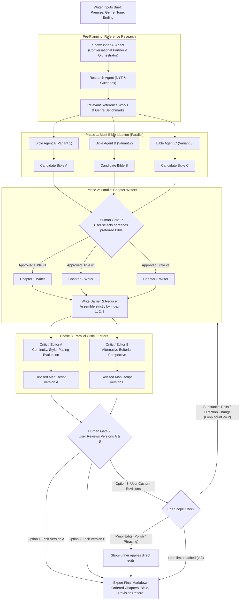
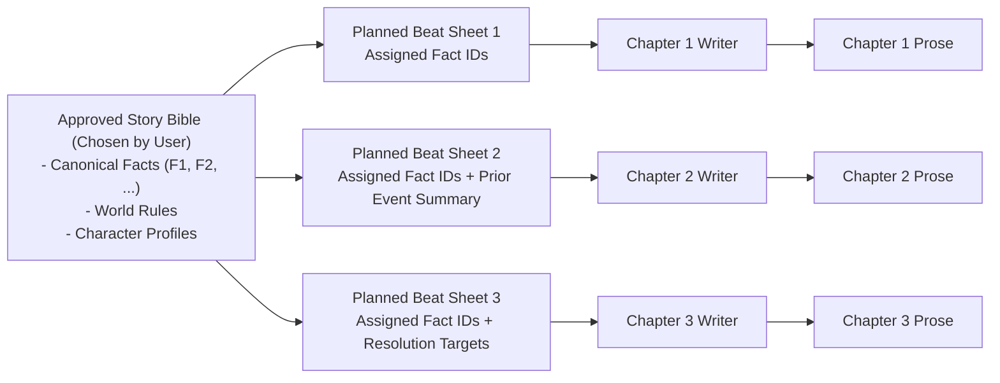

# Multi-Agent Story Builder: Agent Roster & Workflow Lifecycle

This document defines the agent architecture, role boundaries, execution phases, human-in-the-loop gates, and token-maximization technical implementation for the **Multi-Agent Story Builder**.

---

## 1. The Multi-Agent Roster & Responsibilities

The system decouples story creation into specialized, parallel agent roles coordinated by an **AI Showrunner**. Instead of a single planning path or a single editorial review, the architecture emphasizes **comparative options** (multiple candidate bibles and multiple revised draft versions) with writer-guided selection, an interactive conversational interface, and strictly bounded revision loops.

| Role | Lifecycle Phase | Core Responsibility | Input Contract | Output Contract | Model Permissions |
| :--- | :--- | :--- | :--- | :--- | :--- |
| **Showrunner** | Entire Run | Conversational interface to the user and central orchestrator. Greets the writer, coordinates phases via tool dispatch, interprets feedback, and applies direct minor polish edits. | User Chat & Creative Brief (`premise`, `genre`, `audience`, `tone`, `desiredEnding`) + Sub-agent Metadata Cards | Task dispatch envelopes, conversational responses, targeted polish diffs | Conversational orchestrator; can apply direct user polish edits, but cannot alter story direction autonomously. |
| **Research Agent** | Pre-Planning | Retrieves relevant comparable books and genre benchmarks from NYT Books and Gutendex to ground narrative ideation. | Creative brief parameters (`genre`, keywords) | Research evidence (`ResearchEvidence`) with titles, authors, and signals | Read-only research metadata; cannot fabricate missing fields or ratings. |
| **Bible Agent A (Variant 1)** | Phase 1: Ideation | Generates Candidate Story Bible A focusing on thematic interpretation 1. | Creative Brief + Research References | Candidate Story Bible A (facts, world rules, 3 chapter beats) | Bible proposal only; cannot write chapter prose. |
| **Bible Agent B (Variant 2)** | Phase 1: Ideation | Generates Candidate Story Bible B focusing on thematic interpretation 2. | Creative Brief + Research References | Candidate Story Bible B (facts, world rules, 3 chapter beats) | Bible proposal only; cannot write chapter prose. |
| **Bible Agent C (Variant 3)** | Phase 1: Ideation | Generates Candidate Story Bible C focusing on thematic interpretation 3. | Creative Brief + Research References | Candidate Story Bible C (facts, world rules, 3 chapter beats) | Bible proposal only; cannot write chapter prose. |
| **Chapter 1 Writer** | Phase 2: Drafting | Drafts opening scene, setting premise, character stakes, and tone. | Approved Story Bible + Chapter 1 Beat Sheet | `chapterSchema` (`chapterIndex: 1`, `text`) | Prose drafting only; bound by approved bible facts. |
| **Chapter 2 Writer** | Phase 2: Drafting | Drafts confrontation/escalation chapter in parallel with Chapters 1 and 3. | Approved Story Bible + Chapter 2 Beat Sheet + Memory Handoff 2 | `chapterSchema` (`chapterIndex: 2`, `text`) | Prose drafting only; bound by approved bible facts. |
| **Chapter 3 Writer** | Phase 2: Drafting | Drafts climax and resolution chapter in parallel with Chapters 1 and 2. | Approved Story Bible + Chapter 3 Beat Sheet + Memory Handoff 3 | `chapterSchema` (`chapterIndex: 3`, `text`) | Prose drafting only; bound by approved bible facts. |
| **Critic / Editor A** | Phase 3: Revision | Evaluates 3 chapters in parallel with Critic/Editor B; produces **Revised Version A**. | Assembled 3 Chapters + Approved Bible | Complete revised 3-chapter manuscript (Version A) + revision rationale | Editorial revision only; bound by core bible canon. |
| **Critic / Editor B** | Phase 3: Revision | Evaluates 3 chapters from an alternative editorial lens; produces **Revised Version B**. | Assembled 3 Chapters + Approved Bible | Complete revised 3-chapter manuscript (Version B) + revision rationale | Editorial revision only; bound by core bible canon. |

> [!IMPORTANT]
> **Separation of Concerns:** Bible agents propose story foundations; writers generate chapter prose in parallel; critic/editors generate competing revised drafts; the Showrunner facilitates the conversation and applies minor polish edits. The human writer makes the definitive choice at every gate.

---

## 2. End-to-End Multi-Agent Flow & Human Gates

> [!TIP]
> **Hand-Drawn Architecture Charts:** Visual hand-drawn sketches of this workflow are available in [`docs/architecture/assets/flow-architecture-sketch.jpg`](assets/flow-architecture-sketch.jpg) (whiteboard illustration) and [`docs/architecture/assets/flow-architecture-sketch.svg`](assets/flow-architecture-sketch.svg) (vector sketch).



---

### Detailed Lifecycle Breakdown

#### 1. Brief Entry & Research Anchoring
* The writer converses with the AI Showrunner or enters brief fields directly.
* The Showrunner triggers the **Research Agent** (`POST /api/research/benchmarks`), which queries NYT Books and Gutendex for comparable titles and genre patterns.
* Reference metadata is summarized and passed forward into ideation.

#### 2. Phase 1: Multi-Bible Ideation (3 Parallel Bible Agents)
* Rather than a single committee, **three independent Bible Agents** work simultaneously via parallel dispatch.
* Each agent generates a complete candidate Story Bible:
  * **Candidate Bible A:** Emphasizes plot momentum and mystery.
  * **Candidate Bible B:** Emphasizes character depth and emotional conflict.
  * **Candidate Bible C:** Emphasizes world rules, atmosphere, and tension.
* Each candidate bible contains canonical facts with stable IDs (`F1`, `F2`, ...) and three chapter beat sheets.

> [!CAUTION]
> **Human Gate #1 (Story Bible Selection):**
> Execution halts until the human writer reviews all 3 candidate bibles in the artifact reading pane. The writer can:
> 1. Select their preferred candidate outright.
> 2. Make custom refinements to their preferred bible in chat with the Showrunner.
>
> The selected bible becomes the immutable, approved Story Bible v1.

#### 3. Phase 2: Parallel Chapter Drafting & Write Barrier
* Three specialist chapter writers run concurrently:
  * **Chapter 1 Writer:** Establishes character stakes and the inciting incident.
  * **Chapter 2 Writer:** Develops confrontation and mid-story escalation.
  * **Chapter 3 Writer:** Resolves the crisis and concludes the narrative arc.
* Writers rely on canonical facts and structured `MemoryHandoff` milestone summaries rather than waiting for preceding raw prose.
* **Write Barrier:** `orderedChapters()` validates schema adherence and ensures all chapters match Bible v1, sorting output strictly `[1, 2, 3]`.

#### 4. Phase 3: Parallel Critic/Editors (2 Complete Revisions)
* The 3 assembled chapters are sent to **two independent Critic/Editor Agents** running in parallel:
  * **Critic / Editor A:** Focuses on tight narrative continuity, fact adherence, and scene pacing, producing **Revised Version A**.
  * **Critic / Editor B:** Focuses on stylistic elevation, prose voice, and atmospheric tension, producing **Revised Version B**.
* Each critic/editor returns a full, polished, 3-chapter manuscript along with a summary of changes made.

#### 5. Human Gate #2: Writer Decision & Revision Loop
The writer compares **Version A** and **Version B** in the artifact viewer:
* **Option 1:** Accept **Version A** $\to$ Draft finalized.
* **Option 2:** Accept **Version B** $\to$ Draft finalized.
* **Option 3:** Provide **Custom Revisions / Feedback** conversationally to the Showrunner:
  * **Minor Edits:** If feedback consists of line-level polish, dialogue tweaks, or minor phrasing, the **Showrunner** applies the edits directly.
  * **Substantial Edits:** If feedback alters character arcs, introduces new plot elements, or shifts story direction, the workflow **loops back to Phase 2 (Writing Phase)** to redraft the chapters with the new parameters.
* **Token Guardrail:** To prevent runaway model costs and token exhaustion, **the loop back to Phase 2 is strictly limited to 2 cycles**.

---

## 3. Memory & Handoff Dataflow



* **Canonical Fact IDs:** Ground truths remain immutable throughout parallel generation.
* **Reducer Invariant:** Regardless of completion speed, chapters are verified and merged strictly by chapter index `[1, 2, 3]`.

---

## 4. Technical Implementation & Token Maximization (AI Showrunner Architecture)

### The Dual-Channel Architecture (Chat Stream vs. Artifact Stream)

To enable the Showrunner to be an interactive AI conversational agent without causing prompt context bloat, the application decouples **conversational messaging** from **manuscript storage**:

```mermaid
flowchart TD
    subgraph Frontend ["User Interface (Split-Pane)"]
        ChatUI["Left Pane: Conversational Chat\n(User talks with Showrunner)"]
        ArtifactUI["Right Pane: Artifact Reading Pane\n(User inspects Bibles & Manuscripts)"]
    end

    subgraph Backend ["Server & Database Layer"]
        DB[(PostgreSQL Database\nStores Bibles, Chapters, Evidence)]
    end

    subgraph Orchestration ["AI Showrunner & Sub-Agents"]
        ShowrunnerLLM["AI Showrunner Agent\n(Context: ~2,500 Tokens)"]
        SubAgents["Parallel Sub-Agents\n(Writers & Critic/Editors)"]
    end

    ChatUI <--> ShowrunnerLLM
    ShowrunnerLLM -->|Dispatch Tasks| SubAgents
    SubAgents -->|Writes Full 3,000-Word Prose Directly| DB
    SubAgents -->|Returns Lightweight Summary Card (~200 Tokens)| ShowrunnerLLM
    DB -->|Streams Full Content for Visual Inspection| ArtifactUI
```

### Orchestration Runtime Flowchart (Step-by-Step User Flow)

This flowchart details how the central AI Showrunner coordinates tools, background parallel workers, database persistence, and human checkpoints during execution:

```mermaid
flowchart TD
    classDef user fill:#fff3cd,stroke:#d39e00,stroke-width:2px;
    classDef showrunner fill:#e8eaf6,stroke:#3f51b5,stroke-width:2px;
    classDef db fill:#e8f5e9,stroke:#388e3c,stroke-width:2px;
    classDef workers fill:#e1f5fe,stroke:#0288d1,stroke-width:2px;
    classDef decision fill:#fce4ec,stroke:#c2185b,stroke-width:2px;

    Start(["Writer Enters Story Brief in UI"]):::user --> S1["Showrunner AI Agent\n(Receives Brief & System Goal)"]:::showrunner

    subgraph Step1 ["Step 1: Research & Parallel Ideation"]
        S1 -->|"Tool: dispatch_preplanning()"| WorkerP1["Worker Tasks\n(Promise.all)"]:::workers
        WorkerP1 --> RA["Research Agent\n(NYT & Gutendex)"]:::workers
        WorkerP1 --> BA["3 Bible Agents in Parallel\n(Variant A, B, C)"]:::workers
        RA & BA -->|"Write Full Text & Facts"| DB1[("PostgreSQL\n(Stores Research & 3 Bibles)")]:::db
        BA -->|"Return 3 Summary Cards (~200 tokens each)"| S1
    end

    subgraph Gate1 ["Human Gate 1: Story Bible Selection"]
        DB1 -->|"Stream 3 Bibles to Reading Pane"| Artifact1["Artifact Viewer\n(User Reads Bibles)"]:::user
        S1 -->|"Conversational Pitch of 3 Options"| Chat1["Chat Interface\n(User Talks to Showrunner)"]:::user
        Chat1 & Artifact1 -->|"User Selects or Refines Bible v1"| Decision1{"Bible Approved?"}:::decision
    end

    Decision1 -->|"Approved Bible ID"| S2["Showrunner AI Agent\n(Context: ~2,500 Tokens)"]:::showrunner

    subgraph Step2 ["Step 2: Parallel Chapter Drafting"]
        S2 -->|"Tool: dispatch_chapter_writers(bibleId)"| WorkerP2["3 Chapter Writers\n(Promise.all)"]:::workers
        WorkerP2 -->|"Write Chapter 1, 2, 3 Prose"| DB2[("PostgreSQL\n(Stores Chapter Prose)")]:::db
        DB2 --> Reducer["Deterministic Reducer\n(Verifies schemas & sorts [1, 2, 3])"]:::workers
    end

    subgraph Step3 ["Step 3: Parallel Revisions"]
        Reducer -->|"Auto-Trigger Revisions"| WorkerP3["2 Critic / Editors in Parallel"]:::workers
        WorkerP3 -->|"Write Full Manuscript Version A & B"| DB3[("PostgreSQL\n(Stores Manuscripts A & B)")]:::db
        WorkerP3 -->|"Return Version A & B Summary Cards"| S3["Showrunner AI Agent\n(Context: ~3,200 Tokens)"]:::showrunner
    end

    subgraph Gate2 ["Human Gate 2: Final Selection & Feedback"]
        DB3 -->|"Stream Version A & B"| Artifact2["Artifact Viewer\n(Side-by-Side Comparison)"]:::user
        S3 -->|"Presents Differences & Options"| Chat2["Chat Interface\n(Writer Feedback)"]:::user
        Chat2 & Artifact2 --> Decision2{"Writer Decision"}:::decision
    end

    Decision2 -->|"Option 1 (Version A) or Option 2 (Version B)"| Export["Final Export\n(Markdown Package Saved)"]:::db
    Decision2 -->|"Option 3: Custom Feedback"| Classifier["Scope Classifier\n(~300 Token Fast LLM Call)"]:::showrunner

    subgraph Step4 ["Step 4: Revision Loopback Logic"]
        Classifier -->|"Minor Polish (Line edits, typos)"| S_Edit["Showrunner Direct Edit\n(Updates DB directly)"]:::showrunner
        S_Edit --> Export
        Classifier -->|"Substantial Rewrite (Plot, Tone)"| LoopCheck{"Loop Count < 2?"}:::decision
        LoopCheck -->|"Yes: Increment Loop Count"| S2
        LoopCheck -->|"No: Limit Reached"| S_BestEffort["Showrunner Best-Effort Polish\n(Notifies User of Limit)"]:::showrunner --> Export
    end
```



### The Artifact Pointer Pattern

Instead of passing 3,000 words of raw chapter prose or full candidate bibles into the Showrunner's prompt history, sub-agents return lightweight **Metadata Summary Cards**:

```json
{
  "taskId": "task_rev_b",
  "status": "completed",
  "version": "B",
  "wordCount": 3120,
  "styleSummary": "Atmospheric, character-driven with elevated tension.",
  "continuityScore": 5,
  "keyChanges": [
    "Expanded Mara's internal monologue in Chapter 1",
    "Sharpened breakwater confrontation dialogue in Chapter 2"
  ],
  "artifactUrl": "/api/projects/proj-123/manuscripts/version-b"
}
```

The Showrunner discusses the creative options with the writer using these metadata points without needing the full 6,000 words of manuscript text in its LLM context.

### The 300-Token Scope Classifier for Gate #2

When the user enters custom feedback at Human Gate #2, the system evaluates the edit scope using a fast, targeted classification call before taking action:

```typescript
// Lightweight Scope Classifier: ~300 tokens total
const scopePrompt = `
Analyze the writer's revision request:
"${userFeedback}"

Classify into one:
A) MINOR_POLISH: Dialogue tweaks, phrasing fixes, line adjustments, typos.
B) SUBSTANTIAL_REWRITE: Character motivation changes, new plot events, tone shifts, direction changes.

Return JSON: {"type": "MINOR_POLISH" | "SUBSTANTIAL_REWRITE", "rationale": "..."}
`;
```

* **If `MINOR_POLISH`:** The Showrunner fetches only the specific passage requiring changes, applies the edit directly, and saves the update.
* **If `SUBSTANTIAL_REWRITE`:** The server checks `loopCount < 2`. If permitted, it increments the loop counter and triggers Phase 2 (Writing Phase) with the feedback integrated into the chapter beats. If `loopCount >= 2`, it applies best-effort polish and informs the writer that the maximum 2 rewrite cycles have been reached.

### Token Budget Simulation

| Phase & Agent Invocations | Input Tokens | Output Tokens | Total Tokens |
| :--- | :--- | :--- | :--- |
| **Research Pre-Planning** | 500 | 1,000 | 1,500 |
| **Phase 1: 3 Bible Agents (Parallel)** | 4,500 | 6,000 | 10,500 |
| **Showrunner: Gate #1 Discussion** | 2,200 | 600 | 2,800 |
| **Phase 2: 3 Chapter Writers (Parallel)** | 7,500 | 4,000 | 11,500 |
| **Phase 3: 2 Critic/Editors (Parallel)** | 13,000 | 9,000 | 22,000 |
| **Showrunner: Gate #2 Discussion & Option Review** | 3,200 | 800 | 4,000 |
| **Scope Classifier (Gate #2)** | 350 | 50 | 400 |
| **Base Run Total (0 Loops)** | **31,250** | **21,450** | **~52,700 tokens** |
| **+ 1 Substantial Rewrite Loop** | +20,500 | +13,000 | **+33,500 tokens** |
| **+ 2 Substantial Rewrite Loops (Max Cap)** | +41,000 | +26,000 | **+67,000 tokens** |

By using the **Artifact Pointer Pattern**, an AI Showrunner run uses **~52,700 tokens on a clean base run**, remaining comfortably under the **60,000 token budget ceiling**.
