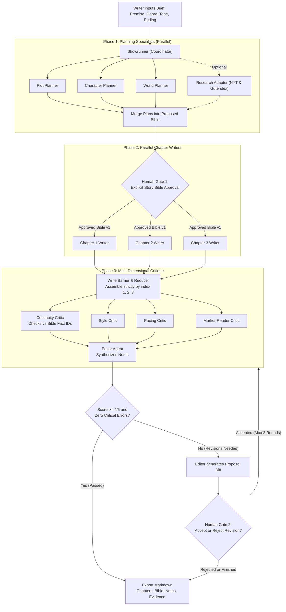
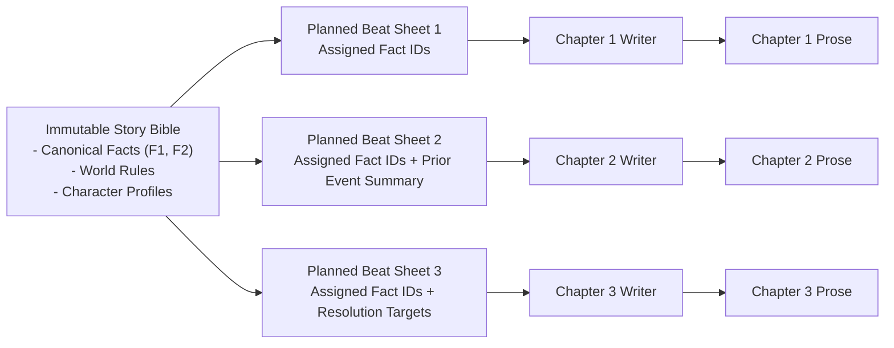

# Multi-Agent Story Builder: Agent Roster & Workflow Lifecycle

This document defines the agent architecture, role boundaries, execution phases, and human-in-the-loop gates for the **Multi-Agent Story Builder**.

---

## 1. The Multi-Agent Roster & Responsibilities

The system decouples story creation into specialized agent roles rather than delegating the entire narrative to a single monolithic prompt. Each role has bounded permissions, explicit inputs, and typed schema outputs.

| Role | Lifecycle Phase | Core Responsibility | Input Contract | Output Contract | Model Permissions |
| :--- | :--- | :--- | :--- | :--- | :--- |
| **Showrunner** | Entire Run | Coordinates phase transitions, enforces budget/token limits, dispatches tasks, and enforces cancellation boundaries. | User Brief (`premise`, `genre`, `audience`, `tone`, `desiredEnding`) | Task dispatch envelopes, run status transitions | Dispatcher only; cannot write prose or self-approve state. |
| **Plot Planner** | Planning (Phase 1) | Deconstructs the premise into overarching plot structure and narrative milestones across 3 chapters. | User Brief + Research Context | Narrative arc and 3 chapter plot beats | Planning only; cannot write chapter prose. |
| **Character Planner** | Planning (Phase 1) | Establishes character profiles, goals, flaws, relationships, and canonical facts. | User Brief | Character sheets and stable fact entities (`id`, `text`) | Planning only; cannot write chapter prose. |
| **World Planner** | Planning (Phase 1) | Establishes physical rules, settings, constraints, and environmental facts. | User Brief | Setting descriptions and stable world rule facts (`id`, `text`) | Planning only; cannot write chapter prose. |
| **Chapter 1 Writer** | Drafting (Phase 2) | Drafts the opening chapter scene, establishing premise, tone, and character stakes. | Approved Bible v1 + Chapter 1 Beat Sheet | `chapterSchema` (`chapterIndex: 1`, `text`) | Prose generation only; cannot alter approved facts. |
| **Chapter 2 Writer** | Drafting (Phase 2) | Drafts the confrontation/escalation chapter concurrently with Chapters 1 and 3. | Approved Bible v1 + Chapter 2 Beat Sheet + Memory Handoff 2 | `chapterSchema` (`chapterIndex: 2`, `text`) | Prose generation only; cannot alter approved facts. |
| **Chapter 3 Writer** | Drafting (Phase 2) | Drafts the climax and resolution chapter concurrently with Chapters 1 and 2. | Approved Bible v1 + Chapter 3 Beat Sheet + Memory Handoff 3 | `chapterSchema` (`chapterIndex: 3`, `text`) | Prose generation only; cannot alter approved facts. |
| **Continuity Critic** | Critique (Phase 3) | Validates draft text against canonical Story Bible facts (`F1`, `F2`, ...); flags contradictions. | Assembled 3 Chapters + Canonical Fact IDs | Located critique notes (`chapterIndex`, `passage`, `factId`, `severity: critical`) | Annotations only; cannot alter prose. |
| **Style Critic** | Critique (Phase 3) | Evaluates voice consistency, tone adherence, sentence rhythm, and figurative language. | Assembled 3 Chapters + Brief Tone | Rubric score (1-5) + stylistic improvement notes | Annotations only; cannot alter prose. |
| **Pacing Critic** | Critique (Phase 3) | Analyzes tension curves, scene progression, exposition balance, and chapter climax placement. | Assembled 3 Chapters + Chapter Beats | Rubric score (1-5) + pacing notes | Annotations only; cannot alter prose. |
| **Market-Reader Critic** | Critique (Phase 3) | Assesses reader engagement against comparable genre patterns (NYT/Gutendex metadata). | Assembled 3 Chapters + `evidenceSchema` | Rubric score (1-5) or `unavailable` flag | Annotations only; cannot invent missing benchmarks. |
| **Editor** | Revision (Phase 3) | Synthesizes all critic notes into an atomic revision proposal diff if scores < 4/5 or critical errors exist. | Critic Notes + Base Chapter Versions | Proposed textual diff (`Proposal` entity) | Diff proposal only; cannot directly commit revisions. |

> [!IMPORTANT]
> **Separation of Concerns:** Planning roles never write prose; writing roles never redefine story facts; critics annotate but cannot edit; the editor generates diffs but cannot commit them. Only the authenticated human writer can commit changes or approve new versions.

---

## 2. End-to-End Multi-Agent Flow & Human Gates

The execution graph is structured around strict phase barriers, fan-out/fan-in concurrency, and two mandatory human approval checkpoints.

---

### Lifecycle Phase Breakdown

#### Phase 1: Planning & Story Bible Assembly
1. **Brief Submission:** The writer provides creative brief inputs (`briefSchema`). The server inspects text formatting and signals via `inspectText`.
2. **Parallel Planning Dispatch:** The Showrunner triggers Plot, Character, and World Planners simultaneously. If research is enabled, the NYT/Gutendex adapter retrieves genre metadata.
3. **Bible Synthesis:** Plans are combined into a single candidate `StoryBibleVersion` containing canonical facts with stable IDs (`F1`, `F2`, ...) and beat sheets for chapters 1, 2, and 3.

> [!CAUTION]
> **Human Gate #1 (Story Bible Approval):**
> Chapter drafting remains strictly blocked until the human writer inspects and explicitly approves this exact Story Bible version. Agents cannot self-approve a story bible.

#### Phase 2: Parallel Chapter Drafting & Write Barrier
1. **Concurrent Dispatch:** Once Bible version $v$ is approved, Chapter Writers 1, 2, and 3 run concurrently.
2. **Decoupled Handoffs:** Writers do not wait for preceding chapters' raw text to finish. Instead, they consume the immutable Story Bible facts and structured `MemoryHandoff` entities containing planned milestones.
3. **Write Barrier:** The graph holds execution until all 3 chapters have finished.
4. **Deterministic Assembly:** `orderedChapters()` validates schema conformity, verifies that every chapter references approved version $v$, and orders the draft strictly by chapter index `[1, 2, 3]`.

#### Phase 3: Multi-Dimensional Critique & Revision Loop
1. **Parallel Critics:** Continuity, Style, Pacing, and Market-Reader critics evaluate the full assembled draft. Critics cite exact passage locations and referenced Fact IDs.
2. **Quality Evaluation:** If all available rubric scores meet the threshold ($\ge 4/5$) and there are zero unresolved critical continuity issues, the draft proceeds directly to export.
3. **Editor Synthesis:** If issues exist, the Editor combines critic findings into a structured diff proposal (`Proposal` entity).

> [!CAUTION]
> **Human Gate #2 (Revision Acceptance):**
> The Editor's proposal is presented to the writer as a reviewable diff. The application commits the changes only upon explicit writer acceptance, and only if the base version has not changed. The loop repeats for at most two revision rounds before final export.

---

## 3. Memory & Handoff Dataflow

To avoid cascading delays and context degradation during parallel generation, context handoffs use structured memory representations:

* **Canonical Fact IDs:** Facts are preserved independently of compressed summaries so that compression never erases ground truth.
* **Deterministic Assembly:** Chapters are sorted by `chapterIndex`, ensuring that arrival order never impacts story sequence.
